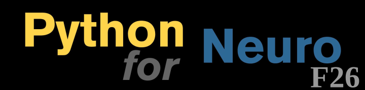

# Introduction to Python for Neuroscientists

Course repository for the Fall 2026 edition of Introduction to Python for Neuroscientists, run by the Columbia Neurobiology and Behavior PhD program.

Course description: This class will give students a general and applied introduction to Python within the context of neuroscience. Topics covered will include setting up python, using git to track and publicize work, programming basics, data manipulation and visualization, machine learning, and navigating existing codebases. The course will culminate in a project where students will analyze data of their choice in Python (options will be provided for students who don’t have their own datasets). Students will then work to understand each other’s projects to get experience reading and understanding each others’ code, and to incentivize good documentation. Students will present their work to the class.

Course Structure: Classes will consist of live programming and instruction, alongside optional out-of-class homework (see important dates below for details). Pair and group-programming will be used in addition to individual programming. Please bring your laptop – if you do not have one / that will be an issue, please contact us.

Prerequisites: No background in programming or math is required. All we ask is that you come with a desire to learn :)

Grades will be based on participation and the final project.

Email: pfncolumbia@gmail.com

Important dates:

* By 9/15: Watch pre-videos, setup computer, and make a github account following these [instructions].
* Weeks 6-7: set up a time if you want to discuss your project with us

Schedule (subject to change):

| **Week**                                                                                                         | **Topic**                                                                                                                                                                                                                                                           | **Lecturer** | **Homework Due**                                                                                                               |
| ---------------------------------------------------------------------------------------------------------------- | ------------------------------------------------------------------------------------------------------------------------------------------------------------------------------------------------------------------------------------------------------------------- | ------------ | ------------------------------------------------------------------------------------------------------------------------------ |
| [Week 1](https://github.com/Columbia-Neuropythonistas/IntroPythonForNeuroscientists2025/tree/main/Week01) (9/15) | Python Workflow: - Use python locally in VSCode in file form and as Jupyter Notebooks (hello world) - Set up conda environment - Git Basics – create a repo and commit to it                                                                                        | Sofiya       | [HW0 (Submit on courseworks)](https://github.com/u-ferah/IntroPythonForNeuroscientists2026/tree/main/Week01)                   |
| Week 2 (9/22)                                                                                                    | Python Basics: - Why use python? - Data Types & Variables (float, int, str, list, dict, tuple) - Booleans & If/Else                                                                                                                                                 | Sofiya       |                                                                                                                                |
| Week 3 (9/29)                                                                                                    | Python Basics: - Lists - Dictionaries- Tuples - For Loops - List Comprehension - Enumerate                                                                                                                                                                          | Utku         |                                                                                                                                |
| Week 4 (10/6)                                                                                                    | Python Basics: - While Loops - Functions - return - *args and **kwargs - Errors - Try/Except - Typehinting/Docstrings                                                                                                                                               | Utku         | [HW4 (Submit on courseworks)](https://github.com/u-ferah/IntroPythonForNeuroscientists2026/tree/main/Week04)                   |
| Week 5 (10/13)                                                                                                   | Numpy: - Why do we need numpy? - Basic numpy functionalty - How to manipulate and read out arrays - How to solve mathematical problems in Python.                                                                                                                   | Utku         |                                                                                                                                |
| Week 6 (10/27)                                                                                                   | Pandas and Data Visualization: - Why is Pandas useful, and why do we need it for data science in Python? - How do we use Pandas to manipulate data? - How can we load and save data in pandas? - How can we plot basic data in Python?                              | Lenca        |                                                                                                                                |
| Week 7 (11/03)                                                                                                   | Data Visualization and Object-oriented programming - How can we make more complicated plots in Python? - How can we use Seaborn to travers and plot large, complex datasets? - How do we use documentation to find solutions to programming questions and problems? | Lenca        |                                                                                                                                |
| Week 8 (11/10)                                                                                                   | Review session. OOP: - What is the basic structure of OOP in Python? - How do we read others' OOP code?                                                                                                                                                           | Sofiya       | [HW8 (Submit on courseworks)](https://github.com/Columbia-Neuropythonistas/IntroPythonForNeuroscientists2023/tree/main/Week08) |
| Week 9 (11/17)                                                                                                   | Navigating an expert codebase: - Given a problem/input and a desired output, how can we use existing resources to implement a solution? - Working through documentation and online resources to learn a package - Adapting prewritten pipelines to custom needs     | Sofiya       |                                                                                                                                |
| Week 10 (11/24)                                                                                                  | Machine learning                                                                                                                                                                                                                                                    | Lenca        |                                                                                                                                |
| Week 11 (12/01)                                                                                                  | Coding with agents + Hypothesis testing                                                                                                                                                                                                                             | Utku         |                                                                                                                                |
| Week 12 (12/08)                                                                                                  | Project Presentation Day                                                                                                                                                                                                                                            |              |                                                                                                                                |

## Project Expectations

You're expected to use the skills you gained during the course on applied problem of your choice. If you're not sure about how exactly to deal with your data, or have any questions about preprocessing steps, contact any of the TAs. 

The final presentation on December 8th should be a 10 to 15 minutes talk followed by a 5 minutes Q&A. You're expected to talk about what is the format of your data, what were the steps you took to analyse it, what were the problems that you found on the way, and how did you deal with them. Please, find an example presentation on courseworks. You can use AI tools to assist with coding, however, you're expected to be able to explain what does the code do and walk us through the main parts. Here is an example [presentation.](https://docs.google.com/presentation/d/1V1XWxcfhv58n9sUY_3Qeb_aPL57wKpf-fso_dHT74E0/edit?usp=sharing)

## Miscellaneous Resources

- Go beyond what we covered in Week 1 with Git, Command Line, Shell, Code Editors and more with [The Missing Semester of Your CS Education](https://missing.csail.mit.edu) from MIT
- [The Good Research Code Handbook by Patrick Mineault](https://goodresearch.dev) -- good principles for writing research code in a quick and enjoyable read. He also provides information about [good tools](https://goodresearch.dev/tools.html#) that are good to explore if you are coding regularly.
